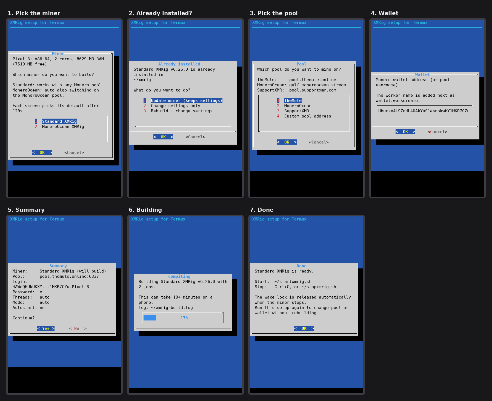

# Build and Run XMRig in Termux (Android)

One script that builds **XMRig** on your Android phone in Termux, asks for your pool and wallet, sizes itself to your phone's hardware, and gives you simple start and stop scripts.

You can build either:

- **Standard XMRig** ([xmrig/xmrig](https://github.com/xmrig/xmrig)): works with any Monero pool. This is the default.
- **MoneroOcean XMRig** ([MoneroOcean/xmrig](https://github.com/MoneroOcean/xmrig)): switches automatically to the most profitable algorithm, but only on the MoneroOcean pool.

Both can be installed side by side. Just run the script twice.

## Quick start

```bash
pkg install -y git
git clone https://github.com/Bitofsin/install-Xmrig-Termux.git
cd install-Xmrig-Termux
chmod +x build_xmrig.sh
./build_xmrig.sh
cd ~
```

The setup runs as a full-screen menu (it installs the small `dialog` package for this). See [Using the setup screens](#using-the-setup-screens) for how to move around. If you'd rather have plain text prompts, run `./build_xmrig.sh --no-tui`.

Answer the questions, wait for the build to finish (often 10+ minutes on a phone; a progress bar shows how far along it is), then start mining:

```bash
~/startxmrig.sh        # Standard XMRig
~/startxmrig-mo.sh     # MoneroOcean XMRig
```

> Install Termux from **F-Droid** or **GitHub**, not the Play Store. The Play Store version is outdated and its packages may fail to install.

## Using the setup screens



There are three ways to answer each screen. Use whichever is easiest on your phone.

**1. Type the number, then press Enter (easiest)**
Every menu option has a number. Press that number to jump to it, then press **Enter**. On yes/no screens, press **Y** or **N**.

**2. Arrow keys**
Termux shows an extra row of keys above the keyboard with arrows, **Tab** and **Esc**.

| Key | What it does |
|-----|--------------|
| ↑ / ↓ | Move up and down a menu |
| Tab | Move between the **OK** and **Cancel** buttons |
| Enter | Confirm |
| Esc | Go with the default answer |

If the extra row isn't showing, hold **Volume Up** and press **Q** to turn it on. You can also hold **Volume Down** and press **W / A / S / D** for up / left / down / right.

**3. Tap**
You can tap an option or a button (**OK**, **Cancel**, **Yes**, **No**) directly.

**Other things to know**
- **Typing text** (custom pool, wallet, worker name, password): the box starts filled with the default. Press **Backspace** to clear it, type your own, then press **Enter**. Pressing Enter without changing anything keeps the default.
- **Cancel** quits the setup without changing anything.
- If you don't answer a screen within **120 seconds**, it moves on with the default answer.

## What you'll be asked

All questions come **before** the build, so the compile can run without you watching it.

| # | Question | Default |
|---|----------|---------|
| 1 | Which miner: Standard XMRig or MoneroOcean XMRig | Standard XMRig |
| 2 | *(only if that miner is already installed)* Update the miner, change settings only, or rebuild and change settings | Update the miner |
| 3 | Pool: TheMule, MoneroOcean, SupportXMR, or custom (`host:port` or `stratum+tcp://host:port`) | Standard XMRig → **TheMule** (`pool.themule.online:6337`)<br>MoneroOcean XMRig → **MoneroOcean** |
| 4 | Use TLS? *(skipped and turned on if you enter a `stratum+ssl://` address)* | No |
| 5 | Wallet address *(checked; a `.workername` suffix is allowed, and you can confirm a username for custom pools)* | Script author's wallet ⚠️ |
| 6 | Worker name *(shown on the pool dashboard; the login is sent as `wallet.workername`)* | Your phone's model, e.g. `Pixel_8` |
| 7 | Pool password *(change it only if your pool uses it for settings like a custom difficulty)* | `x` |
| 8 | Mining threads | `auto` |
| 9 | RandomX mode: `auto`, `fast` or `light` | `auto` |
| 10 | Start on boot? *(needs the Termux:Boot app)* | No |
| 11 | Summary of your choices, then **Continue?** | Yes |

⏰ **Each question waits 120 seconds.** If you don't answer in time, the default is used.

⚠️ **Set your own wallet.** The default wallet belongs to the script author. If you skip that question or let it time out, **you will be mining to someone else's wallet.** Check the summary before you confirm.

## What the script does

1. Checks that it's running in Termux and shows your phone's CPU, core count and RAM.
2. Asks the questions above.
3. Updates Termux and installs the build tools (`git`, `cmake`, `clang`, `make`, `libuv`, `openssl`).
4. Downloads the **latest tagged release** of the miner you picked.
5. Compiles it, using as many parallel jobs as your free RAM allows, up to 4, so the phone doesn't run out of memory or overheat.
6. Installs it to `~/xmrig` (standard) or `~/xmrig-mo` (MoneroOcean).
7. Creates the start script, a stop script, and optionally a boot script.

## Automatic hardware sizing

When threads and mode are left on `auto`, the start script checks your phone **every time it starts**:

- **Threads:** all cores. On phones with more than 4 cores it leaves one free so the phone stays usable.
- **RandomX mode:** `fast` if at least 3 GB of RAM is free, otherwise `light`. Fast is much quicker but needs about 2.5 GB. Light uses very little memory.

You can override either value for a single run:

```bash
THREADS=4 MODE=light ~/startxmrig.sh
```

## Starting, stopping and the wake lock

The start script turns on a **Termux wake lock** so Android doesn't put the CPU to sleep while mining. The lock is **released automatically** however the miner stops: with Ctrl+C, when the stop script is run, or if XMRig crashes.

| Action | Command |
|--------|---------|
| Start | `~/startxmrig.sh` or `~/startxmrig-mo.sh` |
| Stop | **Ctrl+C**, or run `~/stopxmrig.sh` from another Termux session |
| Show hashrate while running | press **h** |
| Pause / resume | press **p** / **r** |

`~/stopxmrig.sh` stops either miner, including one started at boot, and releases any wake lock left behind.

## Start on boot

If you answer yes to *Start on boot*:

1. Install the **Termux:Boot** app from the same place you got Termux (F-Droid or GitHub).
2. Open Termux:Boot **once** so Android allows it to run at startup.
3. After a reboot the miner starts by itself. Its output goes to `~/xmrig.log` or `~/xmrig-mo.log`.

Only one miner is set to start on boot at a time. Enabling one removes the other, so they don't compete for the same cores.

## Updating the miner

To get the newest XMRig release **without touching your pool, wallet or other settings**:

```bash
~/install-Xmrig-Termux/build_xmrig.sh --update
```

- It checks the latest release for each miner you have installed (standard and/or MoneroOcean) and only rebuilds if there's a newer one.
- Only the `xmrig` binary is replaced. Your start script and settings stay exactly as they are.
- If the miner is running, it keeps running the old version until you restart it (`~/stopxmrig.sh`, then start it again).
- To update just one miner: `VARIANT=moneroocean ./build_xmrig.sh --update`.
- To rebuild even if you're already on the latest release: `FORCE=1 ./build_xmrig.sh --update`.

You can also run `./build_xmrig.sh` normally and choose **Update miner** on the first screen.

The script builds tagged **releases**, not the `master` branch. A release is fixed and tested, so every phone gets the same build. `master` changes whenever new code is pushed and can occasionally be broken. If you really want it: `XMRIG_VERSION=master ./build_xmrig.sh --update`.

## Changing settings later

Run `./build_xmrig.sh`, pick the same miner, and choose **Change settings only**. You'll go straight to the pool and wallet questions and skip the compile.

## Skipping the questions

Settings can be passed in up front. This is handy when setting up several phones:

```bash
VARIANT=moneroocean POOL=gulf.moneroocean.stream:10128 \
WALLET=<your_wallet> WORKER=phone2 ./build_xmrig.sh
```

| Variable | Values |
|----------|--------|
| `VARIANT` | `upstream` (standard) or `moneroocean` |
| `POOL` | `host:port`, `stratum+tcp://host:port`, or `stratum+ssl://host:port` |
| `TLS` | `y` or `n` |
| `WALLET` | your wallet address or pool username |
| `WORKER` | worker name |
| `PASSWORD` | pool password (default `x`) |
| `XMRIG_VERSION` | a specific release tag, e.g. `v6.26.0`, or a branch such as `master` |
| `FORCE` | `1` to rebuild on `--update` even when already up to date |

## Tips

- **Heat and battery:** mining runs the CPU flat out. Keep the phone cool and preferably plugged in. If it gets hot, lower the thread count.
- **Android killing the miner:** switch to `MODE=light`, or turn off battery optimization for Termux in Android settings.
- **32-bit phones:** these build and run, but RandomX is much slower than on 64-bit (`aarch64`).

## Release of Liability

By using this script, you acknowledge and agree to the following:

1. The script is provided on an "as-is" basis, without any warranties or guarantees of any kind, express or implied.
2. The script creator shall not be held responsible or liable for any misuse, damage (including damage to your device from heat or battery wear), loss of data, or any other harm caused by the use of this script.
3. You assume all responsibility and liability for the usage of this script.
4. It is your sole responsibility to ensure that you have the necessary authorization and comply with all applicable laws and regulations before engaging in cryptocurrency mining. Only mine on devices you own or have permission to use.
5. The script creator disclaims any and all liability for any actions, damages, or losses resulting from the use or misuse of this script.
